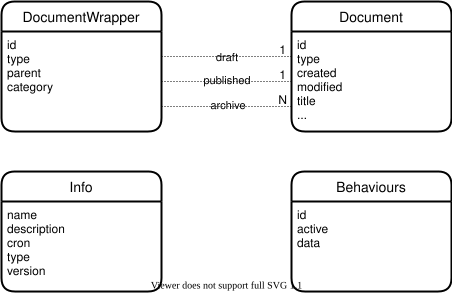
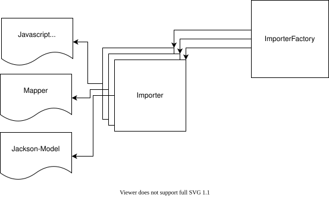

= IGE-NG Software Documentation
:source-highlighter: highlight.js
:highlightjs-languages: kotlin
:toc: left
:toclevels: 3
:stylesheet: ingrid.css

== Introduction

IGE-NG is an open-source metadata editor built with an Angular 21 frontend and a Kotlin/Spring Boot server. This documentation describes the server architecture, extension points, configuration, and development workflows; the repository `README.md` contains the initial local setup and start commands.

The main application code is in `frontend/` and `server/`. Project documentation and operational guides are in `docs/`, with the FAQ in `FAQ.adoc`. Before contributing, set up the database and development environment using the README, then review the testing and configuration sections below.

== Architecture

=== Spring Boot

==== Spring profiles

Spring profiles control which Spring beans and configuration classes are active. A profile-specific properties file can be supplied as `application-<profile>.properties`, but activating a Spring profile does not require such a file. For local development, pass the profiles at startup, for example:

[source,shell]
----
./gradlew bootRun --args='--spring.profiles.active=dev,uvp,ingrid'
----

The profile names below are the activation names used by the application. Catalog profiles determine the catalog type and its document types; Spring profiles determine which server-side beans are loaded. The catalog type and Spring profile commonly share an identifier, but these are separate mechanisms. `dev` enables mock development authentication and must not be enabled in production.

[cols="1,3"]
|===
|Spring profile |Purpose

|`dev`
|Local development configuration, including mock authentication; also makes the test profile components available.

|`test`
|Test profile configuration and document types.

|`mcloud`
|mCLOUD catalog implementation, including its document types and import/export services.

|`uvp`
|UVP catalog implementation and related services.

|`ingrid`
|Base InGrid catalog implementation, including geospatial metadata and ISO export.

|`ingrid-bast`, `ingrid-baw`, `ingrid-bkg`, `ingrid-hmdk`, `ingrid-kommunal-st`, `ingrid-krzn`, `ingrid-lfubayern`, `ingrid-lubw`, `ingrid-up-sh`, `ingrid-with-opendata`, `ingrid-wsv`
|InGrid customer variants. These profiles add or customize the base InGrid implementation; some also include Open Data behavior.

|`opendata`
|Open Data catalog implementation. Open Data beans are also loaded by selected customer catalog profiles.

|`bmi`
|Federal Open Data catalog implementation.

|`codelist-repo`
|Synchronizes code lists from the configured central code-list repository.

|`csw-t`
|Enables CSW Transactions support.

|`ogc-api`
|Enables OGC API for Records.

|`ogc-distributions-api`
|Enables OGC API distribution upload and deletion support.

|`zabbix`
|Enables the Zabbix integration used by UVP document indexing and lifecycle operations.
|===

==== Dependency Injection

The standard Spring Dependency Injection functionality is used.

=== Authentication

Keycloak is the identity provider. In the browser, Spring Security handles the OpenID Connect login and the backend-for-frontend (BFF) keeps OAuth access and refresh tokens on the server. The browser uses a server session cookie (`httpOnly`, and `secure` according to configuration); the Angular application does not manage Keycloak tokens or attach a bearer token itself. Unauthenticated browser API requests receive `401` rather than an interactive redirect.

The backend also configures JWT resource-server authentication for bearer-token API clients. Keycloak users must have an accepted application role (typically `ige-user`); the backend also recognizes the configured administrator role names. API access is authorized using the roles and application permissions described below. In `dev`, Keycloak security is replaced with mock development authentication; never enable that Spring profile in a deployed environment.

[IMPORTANT]
.Browser authentication flow
====
Browser authentication uses the current BFF session flow described here; the earlier frontend-managed bearer-token flow is no longer the browser application's authentication mechanism.
====

The InGrid-Editor is secured by the Backend-For-Frontend Pattern (BFF). Here the frontend does not know anything about the authentication. The backend is completely responsible to handle the access- and refresh-token, as well as the login- and logout-process.

When the application is accessed, the backend checks for a valid session (JSessionID). If there is none, a redirect response to the Keycloak-Login page is sent to the browser. This also includes a state-ID, which is needed to pair the new session with the user who is about to be logged in.

After a successful login, the user is redirected to a special endpoint in the backend to handle the log in. There a session ID is generated, and the access- and refresh-token are stored. The session ID is stored in a secure httpOnly-cookie, which the browser will send automatically with each request. From now on, the backend verifies the session. If the corresponding access-token expires, the backend automatically requests a new one with the refresh-token. If it was successful, the browser will get a valid response. Otherwise a 401-error is being send and the browser is redirected to the Keycloak login page.

=== Authorization

While Keycloak is being used for authentication, the backend handles authorization. This is done by using roles, groups and permissions. The InGrid-Editor has the following roles:

* Super-Admin
* Catalog-Administrator
* Metadata-Administrator
* Author

These roles are used to define access to system functions. For controlling access to the documents, permissions are being used. Permissions are organized in groups. One can create a group and apply various permissions to documents and addresses. The group can then be associated with a user. The information about the user is managed by Keycloak, but the application-specific information is stored on the application-side and the user is connected to Keycloak by the login-name.

=== Model View Controller

==== REST API / Swagger

http://localhost:8550/v3/api-docs

==== Controller / Services

Services are annotated with `@Service` or `@Component` which makes them available to spring's dependency injection.
Instances are singletons by default.
A class that requires a service will typically access it through an `@Autowired` member variable.

==== Persistence

The persistence layer of IGE Server consists of the following main *interfaces* (located in the `de.ingrid.igeserver.persistence` package and it's sub-packages):

* `Repositories` define the access layer to the database.
These are offered by Spring Data and can be easily extended with additional functionality, often without writing any SQL.
* `EntityType` is the base interface for all *document types*.
This could be general domain specific types like
`AddressType` or profile specific types like `MCloudType`.
Services will use these interfaces to execute additional tasks that only the document type itself knows how to handle.
If a document has references to another document or address, then it's his responsibility to handle the resolution of the references, since this data cannot be stored in a relational manner, due to the fact that each document has it's own schema.

=== Database

The database-system is https://www.postgresql.org/[PostgreSQL], which is a relational database with support for JSON fields.
Moreover it supports transaction, so that every (batch of) operation can be rolled back to the previous state.

==== Data model

All data is held in a single database.
That means that all documents of all catalogs are united in that single database.

The data model is shown here:

[plantuml]
----
@startuml

DocumentWrapper "uuid" --> Document
class DocumentWrapper {}
class Document {}

class Info {
--
name
description
cron
type
version
}
class Behaviours {
--
    id
active
data
}

@enduml
----

A `DocumentWrapper` manages different versions of a document.
A document is normally stored in the draft-field.
When it's being published it's removed from the draft-field and put into the published-field.
In case another document version has been in the published-field, it's moved to the archive-field, which can contain a number of documents.

A `Document` can be any kind of data, which has at least a title, the document type and the creation and modification date.
Since Postgres supports NoSQL, the document can be extended without any schema changes and migrations.
By just defining a new field, it's automatically stored in the document table.

The `Catalog` contains information about the catalog itself.
It can also store settings, like a time pattern for indexing.

The `Behaviour` stores the state of a behaviour, which can be changed in the catalog settings of the IGE-NG.
A behaviour can be active or inactive.
It can also contain optional parameters for more flexibility.

=== Extensions

Extensions are used to extend or alter the functionality of IGE Server without changing the core code.
For more information about the concept and implementation see the link:Extensions.adoc#_extension_points[Extensions Documentation].

IGE Server defines the following extension points:

==== Persistency

* `Pipe<PrePersistencePayload>` called *before* any of the persistence operations *create*, *update*, *publish*, *delete*
* `Pipe<PostPersistencePayload>` called *after* any of the persistence operations *create*, *update*, *publish*, *delete*
* `Pipe<PreCreatePayload>` called *before* the persistence operation *create*
* `Pipe<PostCreatePayload>` called *after* the persistence operation *create*
* `Pipe<PreUpdatePayload>` called *before* the persistence operation *update*
* `Pipe<PostUpdatePayload>` called *after* the persistence operation *update*
* `Pipe<PrePublishPayload>` called *before* the persistence operation *publish*
* `Pipe<PostPublishPayload>` called *after* the persistence operation *publish*
* `Pipe<PreDeletePayload>` called *before* the persistence operation *delete*
* `Pipe<PostDeletePayload>` called *after* the persistence operation *delete*

.Beispiel
[%collapsible]
====
[source,kotlin]
----
@Component
class DefaultUpdateValidator : Filter<PreUpdatePayload> {
  override val profiles: Array<String>?
    get() = arrayOf<String>()

  @Autowired
  private lateinit var dbService: DBApi

  override fun invoke(payload: PreUpdatePayload, context: Context): PreUpdatePayload {
    val docId = payload.document[FIELD_ID].asString();

    context.addMessage(Message(this, "Validate document data '$docId' before update"))

    // do checks

    return payload
  }
}
----

====

=== Error Handling

IGE Server defines the following *exception hierarchy*:

* `IgeException` is the base class for all exceptions that could visible to REST API clients.
It contains the following properties:

* `statusCode` The HTTP status code send to the client.
* `errorId` The unique identifier of the exception for getting detail information from the log files.
* `errorCode` A custom error code written in uppercase letters with the underscore character as word separator (e.g. `ALREADY_EXISTS`), that allows clients to identify the error cause.
* `errorText` A custom error text that could presented to the user.
Variables of the form `${variable}` will be replaced by the value of the appropriate key if present in data.
* `data` An optional key-value map used to customize the error text.
* `stackTrace` The stack trace of the exception (only if it was an unexpected exception).

  The `statusCode` value will be used as the HTTP response code, while `errorId`, `errorCode`, `errorText`, `data` and `stackTrace` will be send as JSON encoded string inside the response body.

  The following example shows how a validation error response could look like:

[source,json]
----
  {
    "errorId": "d6c386c7-5c5e-4886-aac3-d8a9ddedf625",
    "errorCode": "VALIDATION_ERROR",
    "errorText": "One or more fields are invalid: title, description.",
    "data": {
      "fields": [
        {
          "name": "title",
          "errorCode": "REQUIRED"
        },
        {
          "name": "description",
          "errorCode": "STRING_LENGTH",
          "data": {
            "min": 50,
            "max": 250
          }
        }
      ]
    }
  }
----

* `ServerException` is the base class for all exceptions that occur while processing a valid request to the REST API.

* Server exceptions have the `statusCode` value *500* if not set to more specific value of *5XX* in sub classes.
* Server exceptions will be logged with *log level ERROR*.

* `ClientException` is the base class for exceptions that are caused by invalid request to the REST API.

* Client exceptions have the `statusCode` value to *400* if not set to more specific value of *4XX* in sub classes.
* Client exceptions will be logged with *log level DEBUG*.

* All other exceptions are sub classes of either `ServerException` or `ClientException`.

All exceptions pass through `de.ingrid.igeserver.RestResponseEntityExceptionHandler` which ensures logging and the response body as described above.

The following *guidelines* should be kept in mind when handling errors:

* Exceptions should not be swallowed.
* Only logging an exception is not a good practice, since it requires monitoring of the log files to discover them.
It's better to let it pass to the client to signal that something went wrong.
* Logging and rethrowing an exception is not necessary, since _all_ exceptions are logged by the global exception handler (see above).
* Exceptions should not be handled unless it's possible to handle them in a meaningful way at that point or it's necessary to add meaningful information.
* Exceptions should be thrown instead of using `ResponseEntity.status(HttpStatus.XXX).build()` or `HttpServletResponse.sendError(HttpServletResponse.XXX, msg)`, because this will ensure the response body as described above.
* Whenever possible, information should be added to the exception that helps to analyze the cause (e.g. which record was failed to update).

=== Logging

IGE Server uses the [Log4j Framework](https://logging.apache.org/log4j/2.x/) with the Log4j Kotlin API.
The configuration is defined in the `log4j2.xml` file.

A class typically creates it's own *logger instance* using the following code

[source,kotlin]
----
private val log = logger()
----

==== Audit Log

An audit log is written for the *documentation of changes* in the application data or to *record specific interactions* with the system.
It consists of special records that answer the question _what_ was done _when_ and by _whom_.

The `de.ingrid.igeserver.services.AuditLogger` component is used to create audit log records with it's `log()` method.
It uses Log4j loggers that can be configured to log to different destinations.
The default logger's name is `audit`.

An *audit log record* consists of the following information:

* A _Category_ used to group records for filtering (e.g. _data-history_)
* An _Action_ specifying the kind of changes applied to the resource (e.g. _delete_)
* An _Actor_ executing the action (the value is usually retrieved automatically from `UserService.getCurrentPrincipal()`)
* The _Time_ when the action took place (the value is usually retrieved automatically from `DateService.now()`)
* The _Target_ of the action (e.g. the unique identifier of the data to which the changes were applied)
* The _Data_ defining the changes that were applied

A typical audit log record looks like the following:

[source,json]
----
{
  "cat": "data-history",
  "action": "delete",
  "actor": "user1",
  "time": "2020-09-07T16:02:11.618768300+02:00",
  "target": "dcf47072-d331-4a4c-bac1-3af64e9c1ea8",
  "data": {
    "_hasChildren": false,
    "_parent": null,
    "@rid": "=47:18",
    "@class": "Document",
    "_created": "2020-08-25T14:29:40.797511700+02:00",
    "@version": 1,
    "_type": "UvpDoc",
    "_id": "dcf47072-d331-4a4c-bac1-3af64e9c1ea8",
    "title": "Test",
    "_modified": "2020-08-25T14:29:40.797511700+02:00"
  }
}
----

If we need to *access the audit log* in the application, the audit log must be stored in the *database*.
This is achieved using the following *configuration*:

* Definition of the database and database table in `application.properties`:

[source,properties]
----
  audit.log.table=audit_log
----

* Configuration of a Log4j appender that writes to that database and database table (in this case an instance of `PostgreSQLAppender`):

[source,xml]
----
  <PostgreSQLAppender name="AuditLogDB" table="${spring:audit.log.table}" />
----

* Configuration of the default Log4j logger used by `AuditLogger` to use this appender:

[source,xml]
----
  <!-- audit logger -->
  <Logger name="audit" level="info" additivity="false">
    <AppenderRef ref="AuditLogDB" />
  </Logger>
----

`AuditLogger` will then be able to connect to the database and retrieve records using it's `find()` method.

==== @AuditLog annotation

A convenient way to create an audit log record each time a method is called is to use the `@AuditLog` annotation.
It creates a record with the following values:

* _Category_: The value of the `category` parameter defined in the annotation (default: _empty string_)
* _Action_: The value of the `action` parameter defined in the annotation (default: class name with the name of the annotated method appended)
* _Target_: The value of the method parameter specified in the `target` parameter, e.g. if target is `id`, the value of the `id` method parameter will become the value of _Target_ (default: _empty string_)
* _Data_ The value of the method parameter specified in the `data` parameter, e.g. if target is `document`, the value of the `document` method parameter will become the value of _Data_ (default: parameter names and values of the annotated method call in JSON notation)

_Actor_ and _Time_ are defined as usual.

NOTE: The audit log record is created *after* the method is executed which means that only _successful_ method executions are recorded.

Using the annotation *without any parameters*

[source,kotlin]
----
@AuditLog
fun updateDocument(id: String, data: JsonNode, publish: Boolean = false) {
  ...
}
----

will result in records of the following form:

[source,json]
----
{
  "cat": "",
  "action": "de.ingrid.igeserver.services.DocumentService.updateDocument",
  "actor": "user1",
  "time": "2020-09-14T17:10:06.145049500+02:00",
  "target": "",
  "data": {
    "data": "{\"title\":\"Test\",\"_id\":\"bd485713-0aba-4140-88cb-dd37675d5973\",\"_parent\":null,\"_type\":\"UvpDoc\",\"_created\":\"2020-09-14T17:04:48.733668500+02:00\",\"_version\":1,\"description\":\"Beschreibung\",\"_modified\":\"2020-09-14T17:10:06.101057900+02:00\"}",
    "publish": "false",
    "id": "bd485713-0aba-4140-88cb-dd37675d5973"
  }
}
----

The following example will create a record similar to the *default data history log* (see below):

[source,kotlin]
----
@AuditLog(category="data-history", action="update", target="id", data="data", logger="audit.data-history")
fun updateDocument(id: String, data: JsonNode, publish: Boolean = false) {
  ...
}
----

==== Data history log

A special category of audit log records are data history records.
They are used to document changes made to the application data.
The data history log is realized in the following way:

* The `de.ingrid.igeserver.persistence.filter.persistence.DataHistoryLogger` class that is implemented as an extension (`Filter`) of the `Pipe<PostPersistencePayload>` extension point and therefor invoked after each persistence operation
* This class uses the following parameters when creating an audit log record:
* _Category_: Value of `audit.log.data-history-category` defined in `application.properties` (default: _data-history_)
* _Logger_: Value of `audit.log.data-history-logger` defined in `application.properties` (default: _audit.data-history_)

This means that data history records can be retrieved by filtering audit log records by a category value of _data-history_.
Since the logger name _audit.data-history_ is a descendent of the default audit log logger, it uses the same configuration by default (especially the same appender), but could be configured in a different way as well.
The produced records look like the example mentioned in the audit log section.

=== Profiles

A catalog profile defines the catalog type and the server behavior associated with it. The backend implements `CatalogProfile`, while the frontend maps the same profile identifier to a `ProfilePack` and registers the document types used by that catalog. A Spring profile activates the server-side components; it does not, by itself, create or select a catalog.

`CatalogProfile.identifier` is serialized as the catalog profile `id`. Keep this value consistent with the Spring activation name and the frontend mapper key. The current contract is:

[cols="1,3"]
|===
|Member |Purpose

|`identifier`, `title`, `description`
|Unique profile ID, display title, and optional description. `identifier`, `title`, and `description` are required members of the interface.

|`indexExportFormatID`, `indexIdField`
|Default index export format and document/address identifier fields used for indexing.

|`linkedProfiles`
|Other profile IDs linked to this profile, commonly used when a profile extends a parent profile. Defaults to an empty list.

|`excludeExportProfiles`
|Profile IDs to omit from the export-format list. Defaults to an empty list.

|`getFacetDefinitionsForDocuments()`, `getFacetDefinitionsForAddresses()`
|Research-page facet and quick-filter definitions for documents and addresses.

|`initCatalogCodelists(catalogId, codelistId)`, `initCatalogQueries(catalogId)`
|Optional initialization of catalog-specific code lists and research queries.

|`initIndices()`
|Optional initialization of index resources.

|`getElasticsearchMapping(format)`, `getElasticsearchSetting(format)`
|Mapping and setting JSON used to configure an Elasticsearch index for an export format.

|`profileSpecificPermissions(permissions, principal)`
|Optional customization of the permissions available to the current principal.

|`additionalImportAnalysis(catalogId, report, message)`
|Optional profile-specific contribution to import analysis and its report message.
|===

Several members have default implementations in `CatalogProfile`; implement or override only the behavior needed by your profile. See `server/src/main/java/de/ingrid/igeserver/services/CatalogProfile.kt` and the existing profiles for concrete examples.

==== Document types

A profile can register one or more document types. Each type has a frontend form definition and a backend `EntityType`. The frontend form is built with [ngx-formly](https://formly.dev/); the backend type supplies a `className`, the catalog profiles that may use it, and optional JSON-schema validation and persistence hooks.

The backend type can handle reference resolution (`getReferenceUUIDs`, `getIncomingReferenceUUIDs`, and related methods), collect referenced uploads, and react to create, update, publish, delete, or unpublish operations. Override only the hooks required by the type. In `EntityType`, an empty `profiles` array means the type is available to all profiles, while `null` means it is available to none. The frontend doctype `id` must match the backend type `className`.

==== Importer

An importer is used to import a file of a defined format.
Multiple importer can be written, which can be chosen during the import process, if several importer can handle the input format.

An importer is a service which implements the interface `IgeImporter`.
With the profile annotation you can define, that the importer is only initialized when a specified profile is active.

The function `canHandleImportFile` is needed to check, if the given file can be imported by this importer.
With the given content and its content-type we should be able to determine if the importer is suitable.
If multiple importer say that they can handle the input file, then the user is presented a choice dialog, to select the correct importer.

After an importer is run, we expect to receive a JsonNode object, which is filled with data coming from the imported file.
The object should represent the JSON format, in which the document is stored in the database.

==== Exporter

An exporter is used to transform the data of a document into another format.
Multiple exporter can be written, which can be chosen during the export process in the frontend.

[plantuml]
----
@startuml
interface IgeExporter {
    run()
    toString()
    calculateFingerprint()
}
IgeExporter <|-- Exporter1

Template1 <- Exporter1
Exporter1 -> Model1

IgeExporter <|-- Exporter2
Template2 <- Exporter2
Exporter2 -> Model2

ExporterFactory "1" o-- "n" IgeExporter
@enduml
----

A profile can offer multiple export formats.
You need to create a new service, which should only be active if the profile is.
This service must implement the interface `IgeExporter` and return a typeInfo with a description of the exporter.
This is also used in the frontend, to choose from a collection of exporters.

It's recommended to use the https://jte.gg/[Java Template Engine (jte)] for creating the exported document.
In combination with a model-class, the template can be easily filled with all the information.
When the model-class implements one of the provided interfaces, e.g. `DCAT` then the same template can be even used for multiple document types.

An exporter is also used for indexing where the document will be converted to a JSON format which is then stored in an Elasticsearch index.
Since the index itself can have a configuration on its own, you can define a settings and mapping configuration for the index.
This can be defined in the profile definition file.

==== Profile creation

Follow these steps for a new profile. Use the same profile ID in the server configuration, the `CatalogProfile`, the frontend mapper, and the catalog type. For example, the ID `sample` is used below.

*Backend*

. Create a package under `server/src/main/java/de/ingrid/igeserver/profiles/<package>/`. Use a valid Kotlin package name; existing customer profile packages use underscores where profile IDs contain hyphens.
. Implement `CatalogProfile` in a `@Service` class in that package. Set `identifier = "sample"`, `title`, `description`, `indexExportFormatID`, and `indexIdField`; provide the required facet, mapping, and setting functions. Add optional code-list, query, index, permission, or import-analysis behavior only if needed.
. Add an `EntityType` for each document type under the package's `types` directory. Annotate each type with `@Component`, set `className` to the document type ID, and set `profiles` to include `"sample"`. For schema validation, place a JSON schema at `server/src/main/resources/sample/schemes/sample.schema.json` and set `jsonSchema = "/sample/schemes/sample.schema.json"`:
+
[source,kotlin]
----
@Component
class SampleDocumentType : EntityType() {
    override val className = "SampleDoc"
    override val profiles = arrayOf("sample")
    override val jsonSchema = "/sample/schemes/sample.schema.json"
}
----

. Add a configuration class under `server/src/main/java/de/ingrid/igeserver/profiles/` to activate and scan the package:
+
[source,kotlin]
----
@Profile("sample")
@Configuration
@ComponentScan(basePackages = ["de.ingrid.igeserver.profiles.sample"])
class SampleConfig
----

The `CatalogProfile` service is discovered by this scan. Do not put `@Profile` on the profile class as a replacement for the configuration class; the configuration is the activation point.

*Frontend*

. Create `frontend/src/profiles/profile-sample.ts`. Define a standalone component that injects the doctypes and registers them with `ProfileService.registerDoctypes()`. Optionally choose the default address type using `setDefaultAddressType()`:
+
[source,typescript]
----
@Component({
  template: "",
  standalone: true,
  changeDetection: ChangeDetectionStrategy.Eager,
})
class SampleProfileComponent {
  constructor(
    private profileService: ProfileService,
    folder: FolderDoctype,
    document: SampleDoctype,
    address: SampleAddressDoctype,
  ) {
    this.profileService.setDefaultAddressType(address);
    this.profileService.registerDoctypes([folder, document, address]);
  }
}

export class ProfilePack {
  static getMyComponent() {
    return SampleProfileComponent;
  }
}
----

. Create each frontend doctype under `frontend/src/profiles/`. Doctypes normally extend `BaseDoctype`; define `id`, `label`, `iconClass`, and `documentFields`. The `id` must match the backend `EntityType.className` exactly. Form fields are ngx-formly `FormlyFieldConfig` values; use the existing base doctype helpers and examples for validation, codelists, and field layout:
+
[source,typescript]
----
@Injectable({ providedIn: "root" })
export class SampleDoctype extends BaseDoctype {
  id = "SampleDoc";
  label = "Sample document";
  iconClass = "doc-icon";
  documentFields = () => <FormlyFieldConfig[]>[];
}
----

. Add `case "sample": return from(import("./profile-sample"));` to `frontend/src/profiles/profile.mapper.ts` so the profile ID loads its `ProfilePack`.
. Add `src/profiles/profile-sample.ts` to the `files` arrays in `frontend/tsconfig.app.json` and `frontend/tsconfig.spec.json`.
. Add profile translations in `frontend/src/profiles/sample/i18n/` as needed. `ProfileService.registerDoctypes()` also requests context-help field IDs for registered doctypes, so provide matching help content when the profile uses contextual help.

*Verify*

. Start the server with both the development profile and the new Spring profile, for example `./gradlew bootRun --args='--spring.profiles.active=dev,sample'`.
. Build the frontend with `yarn build` from `frontend/` and run the relevant tests with `yarn ng test`.
. Create a catalog whose type is `sample`; verify the new type is available, its form saves and validates, and its address type and profile-specific translations/help behave as expected.

==== Profile inheritance

Use profile inheritance when a customer variant should reuse an existing profile but change document fields, validation, permissions, facets, or exports.

* In the child `CatalogProfile`, set a new `identifier`, a customer-specific `title`, and `linkedProfiles = listOf("parent")`. Override only the behavior that differs.
* Create child `EntityType` implementations for types used by the child profile, even when their behavior is initially identical to the parent type. Keep each `className` stable if it is already used by stored data or exports; set the child type's `profiles` to the child profile ID. Override `jsonSchema` when validation differs.
* Add a child config that scans its own package. Also include the child Spring profile name in the parent config's `@Profile` list when the child needs the parent package scanned. This is how the existing InGrid customer variants load the shared InGrid beans.
* In the frontend, create a child standalone component that extends the parent profile component and overrides `getDocTypes()` to return the child doctypes. The child doctype classes can extend parent doctypes to customize fields and validation.
* Add the child profile module to `ProfileMapper` and both frontend TypeScript `files` arrays, just as for a new profile.

See `InGridBastConfig` and `profile-ingrid-bast.ts` for a concrete backend and frontend example.

=== Features
A feature is a functionality that can be enabled or disabled on demand.
The logic for all features should be managed in the directory "features".

==== Feature Activation
Similar to catalog profiles it is possible to activate features with its spring profiles.
In order to ensure that a feature is disabled by default, follow the instructions of *Feature Creation*.

==== Feature Creation
* Create a new package that contains the feature logic in the features-directory:
`server/src/main/java/de/ingrid/igeserver/features/<FeatureNamePackage>`

* Create a new config file for activating the feature in the features-directory:
`server/src/main/java/de/ingrid/igeserver/features/<FeatureNameConfig>`

Example of a feature config file:

[source,kotlin]
----
@Profile("feature-name")
@Configuration
@ComponentScan(basePackages = ["de.ingrid.igeserver.features.[feature-name-package]"])
class FeatureNameConfig
----

=== Export format

The documentation of the export format is here: link:export-format.adoc#_export_format[Definition Export format]

=== Migrations

Whenever it's necessary to update the schema of the database or do some data modifications, you are in need of a migration.
To create a new migration task you need to do the following:

* create a new service in `de.ingrid.igeserver.migrations.tasks` which extends `MigrationBase`
* set new version in `MigrationBase`-constructor
* implement `exec()`-function to run migration for each database

More information can be found in the link:../FAQ.adoc[FAQ].

.Beispiel
[%collapsible]
====
[source,kotlin]
----
include::../server/src/main/java/de/ingrid/igeserver/migrations/tasks/M020AddCodelistTable.kt[lines=12..]
----
====

== Permissions

The topic about handling permissions can be found here: link:permissions.adoc#_permissions_authorisation[Permission-Documentation]

== Configuration

include::_environment.adoc[]

include::_testing.adoc[]

include::_deployment.adoc[]

include::_interfaces.adoc[]
