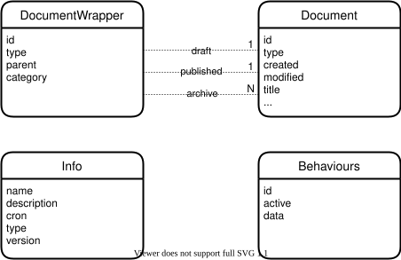
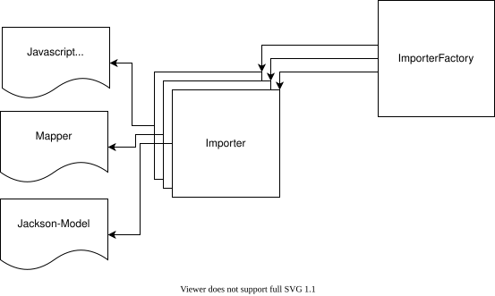

= InGrid-Editor Software Documentation
:source-highlighter: highlight.js
:highlightjs-languages: kotlin
:toc: left
:toclevels: 3
:stylesheet: ingrid.css

== Introduction

InGrid-Editor is an open-source metadata editor built with an Angular 21 frontend and a Kotlin/Spring Boot server. This documentation describes the server architecture, extension points, configuration, and development workflows; the repository `README.md` contains the initial local setup and start commands.

The main application code is in `frontend/` and `server/`. Project documentation and operational guides are in `docs/`, with the FAQ in `FAQ.adoc`. Before contributing, set up the database and development environment using the README, then review the testing and configuration sections below.

== Architecture

=== Spring Boot

==== Spring profiles

Spring profiles control which Spring beans and configuration classes are active. A profile-specific properties file can be supplied as `application-<profile>.properties`, but activating a Spring profile does not require such a file. For local development, pass the profiles at startup, for example:

[source,shell]
----
./gradlew bootRun --args='--spring.profiles.active=dev,uvp,ingrid'
----

The profile names below are the activation names used by the application. Catalog profiles determine the catalog type and its document types; Spring profiles determine which server-side beans are loaded. The catalog type and Spring profile commonly share an identifier, but these are separate mechanisms. `dev` enables mock development authentication and must not be enabled in production.

[cols="1,3"]
|===
|Spring profile |Purpose

|`dev`
|Local development configuration, including mock authentication; also makes the test profile components available.

|`test`
|Test profile configuration and document types.

|`uvp`
|UVP catalog implementation and related services.

|`ingrid`
|Base InGrid catalog implementation, including geospatial metadata and ISO export.

|`ingrid-bast`, `ingrid-baw`, `ingrid-bkg`, `ingrid-hmdk`, `ingrid-kommunal-st`, `ingrid-krzn`, `ingrid-lfubayern`, `ingrid-lubw`, `ingrid-up-sh`, `ingrid-with-opendata`, `ingrid-wsv`
|InGrid customer variants. These profiles add or customize the base InGrid implementation; some also include Open Data behavior.

|`opendata`
|Open Data catalog implementation. Open Data beans are also loaded by selected customer catalog profiles.

|`bmi`
|Federal Open Data catalog implementation.

|`codelist-repo`
|Synchronizes code lists from the configured central code-list repository.

|`csw-t`
|Enables CSW Transactions support.

|`ogc-api`
|Enables OGC API for Records.

|`ogc-distributions-api`
|Enables OGC API distribution upload and deletion support.

|`zabbix`
|Enables the Zabbix integration used by UVP document indexing and lifecycle operations.
|===

==== Dependency Injection

The standard Spring Dependency Injection functionality is used.

=== Authentication

Keycloak is the identity provider. For browser page navigation, Spring Security handles the OpenID Connect login; an unauthenticated visit to a protected application page redirects to Keycloak. The backend-for-frontend (BFF) keeps OAuth access and refresh tokens on the server and gives the browser a session cookie (`httpOnly`, and `secure` according to configuration). The Angular application does not manage Keycloak tokens or attach a bearer token itself. Unauthenticated API requests receive `401` rather than an interactive login redirect.

The backend also configures JWT resource-server authentication for bearer-token API clients. Keycloak users must have an accepted application role (typically `ige-user`); the backend also recognizes the configured administrator role names. API access is authorized using the roles and application permissions described below. In `dev`, Keycloak security is replaced with mock development authentication; never enable that Spring profile in a deployed environment.

=== Authorization

While Keycloak is being used for authentication, the backend handles authorization. This is done by using roles, groups and permissions. The InGrid-Editor has the following roles:

* Super-Admin
* Catalog-Administrator
* Metadata-Administrator
* Author

These roles are used to define access to system functions. For controlling access to the documents, permissions are being used. Permissions are organized in groups. One can create a group and apply various permissions to documents and addresses. The group can then be associated with a user. The information about the user is managed by Keycloak, but the application-specific information is stored on the application-side and the user is connected to Keycloak by the login-name.

=== Model View Controller

==== REST API / Swagger

http://localhost:8550/v3/api-docs

==== Controller / Services

Services are annotated with `@Service` or `@Component` which makes them available to spring's dependency injection.
Instances are singletons by default.
A class that requires a service will typically access it through an `@Autowired` member variable.

==== Persistence

The persistence layer of IGE Server consists of the following main *interfaces* (located in the `de.ingrid.igeserver.persistence` package and its sub-packages):

* `Repositories` define the access layer to the database.
These are offered by Spring Data and can be easily extended with additional functionality, often without writing any SQL.
* `EntityType` is the base interface for all *document types*.
This could be general domain specific types like `AddressType`.
Services will use these interfaces to execute additional tasks that only the document type itself knows how to handle.
If a document has references to another document or address, the document type is responsible for resolving them. This data cannot be stored relationally because each document has its own schema.

=== Database

The database-system is https://www.postgresql.org/[PostgreSQL], which is a relational database with support for JSON fields.
Moreover it supports transaction, so that every (batch of) operation can be rolled back to the previous state.

==== Data model

All data is held in a single database.
That means that all documents of all catalogs are united in that single database.

The data model is shown here:

[plantuml]
----
@startuml

DocumentWrapper "uuid" --> Document
class DocumentWrapper {}
class Document {}

class Info {
--
name
description
cron
type
version
}
class Behaviours {
--
    id
active
data
}

@enduml
----

A `DocumentWrapper` manages different versions of a document.
A document is normally stored in the draft-field.
When it's being published it's removed from the draft-field and put into the published-field.
In case another document version has been in the published-field, it's moved to the archive-field, which can contain a number of documents.

A `Document` can be any kind of data, which has at least a title, the document type and the creation and modification date.
Since Postgres supports NoSQL, the document can be extended without any schema changes and migrations.
By just defining a new field, it's automatically stored in the document table.

The `Catalog` contains information about the catalog itself.
It can also store settings, like a time pattern for indexing.

The `Behaviour` stores the state of a behaviour, which can be changed in the catalog settings of the InGrid-Editor.
A behaviour can be active or inactive.
It can also contain optional parameters for more flexibility.

=== Extensions

Extensions are used to extend or alter the functionality of IGE Server without changing the core code.
For more information about the concept and implementation see the link:Extensions.adoc#_extension_points[Extensions Documentation].

IGE Server defines the following extension points:

==== Persistency

* `Pipe<PrePersistencePayload>` called *before* any of the persistence operations *create*, *update*, *publish*, *delete*
* `Pipe<PostPersistencePayload>` called *after* any of the persistence operations *create*, *update*, *publish*, *delete*
* `Pipe<PreCreatePayload>` called *before* the persistence operation *create*
* `Pipe<PostCreatePayload>` called *after* the persistence operation *create*
* `Pipe<PreUpdatePayload>` called *before* the persistence operation *update*
* `Pipe<PostUpdatePayload>` called *after* the persistence operation *update*
* `Pipe<PrePublishPayload>` called *before* the persistence operation *publish*
* `Pipe<PostPublishPayload>` called *after* the persistence operation *publish*
* `Pipe<PreDeletePayload>` called *before* the persistence operation *delete*
* `Pipe<PostDeletePayload>` called *after* the persistence operation *delete*

.Example
[%collapsible]
====
[source,kotlin]
----
@Component
class DefaultUpdateValidator : Filter<PreUpdatePayload> {
  override val profiles: Array<String>?
    get() = arrayOf<String>()

  @Autowired
  private lateinit var dbService: DBApi

  override fun invoke(payload: PreUpdatePayload, context: Context): PreUpdatePayload {
    val docId = payload.document[FIELD_ID].asString();

    context.addMessage(Message(this, "Validate document data '$docId' before update"))

    // do checks

    return payload
  }
}
----

====

=== Error Handling

IGE Server defines the following *exception hierarchy*:

* `IgeException` is the base class for all exceptions that could visible to REST API clients.
It contains the following properties:

* `statusCode` The HTTP status code send to the client.
* `errorId` The unique identifier of the exception for getting detail information from the log files.
* `errorCode` A custom error code written in uppercase letters with the underscore character as word separator (e.g. `ALREADY_EXISTS`), that allows clients to identify the error cause.
* `errorText` A custom error text that could presented to the user.
Variables of the form `${variable}` will be replaced by the value of the appropriate key if present in data.
* `data` An optional key-value map used to customize the error text.
* `stackTrace` The stack trace of the exception (only if it was an unexpected exception).

  The `statusCode` value will be used as the HTTP response code, while `errorId`, `errorCode`, `errorText`, `data` and `stackTrace` will be send as JSON encoded string inside the response body.

  The following example shows how a validation error response could look like:

[source,json]
----
  {
    "errorId": "d6c386c7-5c5e-4886-aac3-d8a9ddedf625",
    "errorCode": "VALIDATION_ERROR",
    "errorText": "One or more fields are invalid: title, description.",
    "data": {
      "fields": [
        {
          "name": "title",
          "errorCode": "REQUIRED"
        },
        {
          "name": "description",
          "errorCode": "STRING_LENGTH",
          "data": {
            "min": 50,
            "max": 250
          }
        }
      ]
    }
  }
----

* `ServerException` is the base class for all exceptions that occur while processing a valid request to the REST API.

* Server exceptions have the `statusCode` value *500* if not set to more specific value of *5XX* in sub classes.
* Server exceptions will be logged with *log level ERROR*.

* `ClientException` is the base class for exceptions that are caused by invalid request to the REST API.

* Client exceptions have the `statusCode` value to *400* if not set to more specific value of *4XX* in sub classes.
* Client exceptions will be logged with *log level DEBUG*.

* All other exceptions are sub classes of either `ServerException` or `ClientException`.

All exceptions pass through `de.ingrid.igeserver.RestResponseEntityExceptionHandler` which ensures logging and the response body as described above.

The following *guidelines* should be kept in mind when handling errors:

* Exceptions should not be swallowed.
* Only logging an exception is not a good practice, since it requires monitoring of the log files to discover them.
It's better to let it pass to the client to signal that something went wrong.
* Logging and rethrowing an exception is not necessary, since _all_ exceptions are logged by the global exception handler (see above).
* Exceptions should not be handled unless it's possible to handle them in a meaningful way at that point or it's necessary to add meaningful information.
* Exceptions should be thrown instead of using `ResponseEntity.status(HttpStatus.XXX).build()` or `HttpServletResponse.sendError(HttpServletResponse.XXX, msg)`, because this will ensure the response body as described above.
* Whenever possible, information should be added to the exception that helps to analyze the cause (e.g. which record was failed to update).

=== Logging

IGE Server uses the https://logging.apache.org/log4j/2.x/[Log4j Framework] with the Log4j Kotlin API.
The configuration is defined in the `log4j2.xml` file.

A class typically creates its own *logger instance* using the following code

[source,kotlin]
----
private val log = logger()
----

==== Audit Log

An audit log is written for the *documentation of changes* in the application data or to *record specific interactions* with the system.
It consists of special records that answer the question _what_ was done _when_ and by _whom_.

The `de.ingrid.igeserver.services.AuditLogger` component is used to create audit log records with its `log()` method.
It uses Log4j loggers that can be configured to log to different destinations.
The default logger's name is `audit`.

An *audit log record* consists of the following information:

* A _Category_ used to group records for filtering (e.g. _data-history_)
* An _Action_ specifying the kind of changes applied to the resource (e.g. _delete_)
* An _Actor_ executing the action (the value is usually retrieved automatically from `UserService.getCurrentPrincipal()`)
* The _Time_ when the action took place (the value is usually retrieved automatically from `DateService.now()`)
* The _Target_ of the action (e.g. the unique identifier of the data to which the changes were applied)
* The _Data_ defining the changes that were applied

A typical audit log record looks like the following:

[source,json]
----
{
  "cat": "data-history",
  "action": "delete",
  "actor": "user1",
  "time": "2020-09-07T16:02:11.618768300+02:00",
  "target": "dcf47072-d331-4a4c-bac1-3af64e9c1ea8",
  "data": {
    "_hasChildren": false,
    "_parent": null,
    "@rid": "=47:18",
    "@class": "Document",
    "_created": "2020-08-25T14:29:40.797511700+02:00",
    "@version": 1,
    "_type": "UvpDoc",
    "_id": "dcf47072-d331-4a4c-bac1-3af64e9c1ea8",
    "title": "Test",
    "_modified": "2020-08-25T14:29:40.797511700+02:00"
  }
}
----

If we need to *access the audit log* in the application, the audit log must be stored in the *database*.
This is achieved using the following *configuration*:

* Definition of the database and database table in `application.properties`:

[source,properties]
----
  audit.log.table=audit_log
----

* Configuration of a Log4j appender that writes to that database and database table (in this case an instance of `PostgreSQLAppender`):

[source,xml]
----
  <PostgreSQLAppender name="AuditLogDB" table="${spring:audit.log.table}" />
----

* Configuration of the default Log4j logger used by `AuditLogger` to use this appender:

[source,xml]
----
  <!-- audit logger -->
  <Logger name="audit" level="info" additivity="false">
    <AppenderRef ref="AuditLogDB" />
  </Logger>
----

`AuditLogger` will then be able to connect to the database and retrieve records using its `find()` method.

==== @AuditLog annotation

A convenient way to create an audit log record each time a method is called is to use the `@AuditLog` annotation.
It creates a record with the following values:

* _Category_: The value of the `category` parameter defined in the annotation (default: _empty string_)
* _Action_: The value of the `action` parameter defined in the annotation (default: class name with the name of the annotated method appended)
* _Target_: The value of the method parameter specified in the `target` parameter, e.g. if target is `id`, the value of the `id` method parameter will become the value of _Target_ (default: _empty string_)
* _Data_ The value of the method parameter specified in the `data` parameter, e.g. if target is `document`, the value of the `document` method parameter will become the value of _Data_ (default: parameter names and values of the annotated method call in JSON notation)

_Actor_ and _Time_ are defined as usual.

NOTE: The audit log record is created *after* the method is executed which means that only _successful_ method executions are recorded.

Using the annotation *without any parameters*

[source,kotlin]
----
@AuditLog
fun updateDocument(id: String, data: JsonNode, publish: Boolean = false) {
  ...
}
----

will result in records of the following form:

[source,json]
----
{
  "cat": "",
  "action": "de.ingrid.igeserver.services.DocumentService.updateDocument",
  "actor": "user1",
  "time": "2020-09-14T17:10:06.145049500+02:00",
  "target": "",
  "data": {
    "data": "{\"title\":\"Test\",\"_id\":\"bd485713-0aba-4140-88cb-dd37675d5973\",\"_parent\":null,\"_type\":\"UvpDoc\",\"_created\":\"2020-09-14T17:04:48.733668500+02:00\",\"_version\":1,\"description\":\"Beschreibung\",\"_modified\":\"2020-09-14T17:10:06.101057900+02:00\"}",
    "publish": "false",
    "id": "bd485713-0aba-4140-88cb-dd37675d5973"
  }
}
----

The following example will create a record similar to the *default data history log* (see below):

[source,kotlin]
----
@AuditLog(category="data-history", action="update", target="id", data="data", logger="audit.data-history")
fun updateDocument(id: String, data: JsonNode, publish: Boolean = false) {
  ...
}
----

==== Data history log

A special category of audit log records are data history records.
They are used to document changes made to the application data.
The data history log is realized in the following way:

* The `de.ingrid.igeserver.persistence.filter.persistence.DataHistoryLogger` class that is implemented as an extension (`Filter`) of the `Pipe<PostPersistencePayload>` extension point and therefor invoked after each persistence operation
* This class uses the following parameters when creating an audit log record:
* _Category_: Value of `audit.log.data-history-category` defined in `application.properties` (default: _data-history_)
* _Logger_: Value of `audit.log.data-history-logger` defined in `application.properties` (default: _audit.data-history_)

This means that data history records can be retrieved by filtering audit log records by a category value of _data-history_.
Since the logger name _audit.data-history_ is a descendent of the default audit log logger, it uses the same configuration by default (especially the same appender), but could be configured in a different way as well.
The produced records look like the example mentioned in the audit log section.

=== Profiles

A catalog profile defines a catalog type and the server behavior associated with it. The backend implements `CatalogProfile`; the frontend maps the same profile ID to a `ProfilePack` and registers the document types used by that catalog. Activating a Spring profile loads server components; it does not create a catalog or make it the current catalog.

==== Profile IDs and names

Use the same profile ID (shown as `<id>` below) at every integration point. Profile IDs may contain hyphens; Kotlin package names may not, so use underscores in the package name (for example, `ingrid-bast` uses package `ingrid_bast`). Keep resource and frontend profile folders named with the profile ID, including its hyphens.

[cols="1,3"]
|===
|Location |Contract

|Spring activation
|The profile config has `@Profile("<id>")`; activate this name in the Spring profile list.

|Backend catalog profile
|`CatalogProfile.identifier` equals `<id>` and is serialized as `id` in the profile API.

|Catalog type
|The catalog's `type` is `<id>`; this is how the application selects the profile.

|Frontend mapper
|`ProfileMapper` has a case for `<id>` that loads the matching `profile-<id>` module.

|Frontend files and assets
|The profile component is `frontend/src/profiles/profile-<id>.ts`; profile-specific doctypes, translations, and optional static assets live under `frontend/src/profiles/<id>/`.

|Backend resources
|Schemas and index JSON resources live under `server/src/main/resources/<id>/`.

|Context help
|Help files live under `server/src/main/resources/contextHelp/<id>/`; their `profile` metadata must equal `<id>`.

|Document type ID
|For each document type, frontend `Doctype.id` must exactly equal backend `EntityType.className`. This is separate from the profile ID.
|===

==== CatalogProfile

The main members of `CatalogProfile` are:

[cols="1,3"]
|===
|Member |Purpose

|`identifier`, `title`, `description`
|The unique profile ID, display title, and optional description. These members are required by the interface.

|`indexExportFormatID`, `indexIdField`
|Default index export format and document/address identifier fields used for indexing.

|`linkedProfiles`
|Other profile IDs linked to this profile, commonly used when extending a parent profile. Defaults to an empty list.

|`excludeExportProfiles`
|Profile IDs to omit from the export-format list. Defaults to an empty list.

|`getFacetDefinitionsForDocuments()`, `getFacetDefinitionsForAddresses()`
|Research-page facet and quick-filter definitions for documents and addresses.

|`initCatalogCodelists(catalogId, codelistId)`, `initCatalogQueries(catalogId)`
|Optional initialization of catalog-specific code lists and research queries.

|`initIndices()`
|Optional initialization of index resources.

|`getElasticsearchMapping(format)`, `getElasticsearchSetting(format)`
|Mapping and setting JSON used to configure an Elasticsearch index for an export format.

|`profileSpecificPermissions(permissions, principal)`
|Optional customization of the permissions available to the current principal.

|`additionalImportAnalysis(catalogId, report, message)`
|Optional profile-specific contribution to import analysis and its report message.
|===

Several members have default implementations; implement or override only the behavior needed by the profile. See `server/src/main/java/de/ingrid/igeserver/services/CatalogProfile.kt` for examples.

==== Document types

A profile can register one or more document types. Each type has a frontend form definition and a backend `EntityType`. The frontend form is built with https://formly.dev/[ngx-formly]; the backend type supplies a `className`, the catalog profiles that may use it, and optional JSON Schema validation and persistence hooks.

The backend type can handle reference resolution (`getReferenceUUIDs`, `getIncomingReferenceUUIDs`, and related methods), collect referenced uploads, and react to create, update, publish, delete, or unpublish operations. Override only the hooks required by the type. In `EntityType`, an empty `profiles` array means the type is available to all profiles, while `null` means it is available to none. The frontend doctype `id` must match the backend type `className`.

==== Importer

An importer is used to import a file of a defined format.
Multiple importers can be written; if several can handle the input format, the user can choose one during the import process.

An importer is a service that implements `IgeImporter`.
Use a Spring `@Profile` annotation when the importer should only be initialized while a specified profile is active.

The `canHandleImportFile` function checks whether the importer can handle the given file. Use its content and content type to determine suitability. If multiple importers report that they can handle the input, the user is presented with a choice dialog.

An importer returns a `JsonNode` containing the imported data in the JSON format used to store the document in the database.

==== Exporter

An exporter transforms document data into another format.
Multiple exporters can be provided for users to choose from in the frontend during export.

[plantuml]
----
@startuml
interface IgeExporter {
    run()
    toString()
    calculateFingerprint()
}
IgeExporter <|-- Exporter1

Template1 <- Exporter1
Exporter1 -> Model1

IgeExporter <|-- Exporter2
Template2 <- Exporter2
Exporter2 -> Model2

ExporterFactory "1" o-- "n" IgeExporter
@enduml
----

A profile can offer multiple export formats.
You need to create a new service, which should only be active if the profile is.
This service must implement the interface `IgeExporter` and return a typeInfo with a description of the exporter.
This is also used in the frontend, to choose from a collection of exporters.

It's recommended to use the https://jte.gg/[Java Template Engine (jte)] for creating the exported document.
In combination with a model-class, the template can be easily filled with all the information.
When the model-class implements one of the provided interfaces, e.g. `DCAT` then the same template can be even used for multiple document types.

An exporter is also used for indexing: it converts the document to JSON for storage in an Elasticsearch index. The index mapping and settings are supplied by `CatalogProfile.getElasticsearchMapping(format)` and `CatalogProfile.getElasticsearchSetting(format)`, typically by reading JSON resources from `server/src/main/resources/<id>/`.

==== Profile creation

Use the following sequence for a new profile. The examples use profile ID `sample` and document type ID `SampleDoc`; substitute your own values consistently.

The following overview shows all files involved in creating the `sample` profile. Files marked `[+]` are new, files marked `[~]` are existing files that must be modified, and files marked `(optional)` are only needed if the profile uses that feature. The numbers refer to the steps below.

[source,text]
----
ingrid-editor/
├── server/src/main/
│   ├── java/de/ingrid/igeserver/profiles/
│   │   ├── SampleConfig.kt                    [+]  Spring @Profile("sample") + @ComponentScan     (4)
│   │   └── sample/                            [+]  profile package (use underscores for hyphens)  (1)
│   │       ├── SampleProfile.kt               [+]  CatalogProfile implementation                  (2)
│   │       ├── types/
│   │       │   ├── SampleDocumentType.kt      [+]  document EntityType                            (3)
│   │       │   ├── SamplePersonType.kt        [+]  person address EntityType                      (3)
│   │       │   └── SampleOrganisationType.kt  [+]  organisation address EntityType                (3)
│   │       ├── importer/ …                    [+]  IgeImporter services             (optional)    (5)
│   │       └── exporter/ …                    [+]  exporter services                (optional)    (5)
│   └── resources/
│       ├── sample/                            [+]  backend resources, named after the profile ID  (1)
│       │   ├── schemes/
│       │   │   ├── sample.schema.json         [+]  document schema, if used                       (3)
│       │   │   ├── sample-person.schema.json  [+]  person address schema, if used                 (3)
│       │   │   └── sample-organisation.schema.json [+] organisation schema, if used               (3)
│       │   ├── default-mapping.json           [+]  Elasticsearch mapping            (optional)    (2)
│       │   └── default-settings.json          [+]  Elasticsearch settings           (optional)    (2)
│       └── contextHelp/
│           └── sample/                        [+]  context help                     (optional)    (5)
│               ├── sampleField.md             [+]  German help (front matter: id, docType, profile)
│               └── en/
│                   └── sampleField.md         [+]  English help
└── frontend/
    ├── tsconfig.app.json                      [~]  add src/profiles/profile-sample.ts to "files"  (9)
    ├── tsconfig.spec.json                     [~]  add src/profiles/profile-sample.ts to "files"  (9)
    └── src/profiles/
        ├── profile.mapper.ts                  [~]  add case "sample"                              (8)
        ├── profile-sample.ts                  [+]  profile component + ProfilePack                (7)
        └── sample/                            [+]  frontend profile folder, named after the ID
            ├── sample.doctype.ts              [+]  Doctype, id = "SampleDoc"                      (6)
            ├── sample-person.doctype.ts        [+]  PersonDoctype, id = "SamplePersonDoc"         (6)
            ├── sample-organisation.doctype.ts  [+]  OrganisationDoctype, id = "SampleOrganisationDoc" (6)
            ├── i18n/
            │   ├── de.json                    [+]  German translations                           (10)
            │   └── en.json                    [+]  English translations             (optional)   (10)
            └── assets/ …                      [+]  icons and static files           (optional)   (10)
----

When the new profile extends an existing profile (see <<Profile inheritance>>), the same structure applies, but the new classes extend or reuse those of the parent profile and the parent ID is listed in `linkedProfiles`.

. **Create the backend package and resources.** Add a Kotlin package below `server/src/main/java/de/ingrid/igeserver/profiles/`. Use a valid package name (for example, `ingrid_bast` for profile ID `ingrid-bast`). Create `server/src/main/resources/<id>/` for profile-specific schemas and index JSON.
. **Implement `CatalogProfile`.** Add a `@Service` class under the package. The example uses `portal` as the index export format and `uuid` for both index ID fields; choose values that match your export and document/address data. The facet methods can return empty arrays when the profile has no facets.
+
.server/src/main/java/de/ingrid/igeserver/profiles/sample/SampleProfile.kt
[source,kotlin]
----
package de.ingrid.igeserver.profiles.sample

import de.ingrid.igeserver.model.FacetGroup
import de.ingrid.igeserver.services.CatalogProfile
import de.ingrid.igeserver.services.IndexIdFieldConfig
import org.springframework.stereotype.Service

@Service
class SampleProfile : CatalogProfile {
    override val identifier = "sample"
    override val title = "Sample catalog"
    override val description: String? = null
    override val indexExportFormatID = "portal"
    override val indexIdField = IndexIdFieldConfig("uuid", "uuid")

    override fun getFacetDefinitionsForDocuments(): Array<FacetGroup> = emptyArray()
    override fun getFacetDefinitionsForAddresses(): Array<FacetGroup> = emptyArray()

    // optional
    override fun getElasticsearchMapping(format: String): String =
        {}.javaClass.getResource("/sample/default-mapping.json").readText()

    // optional
    override fun getElasticsearchSetting(format: String): String =
        {}.javaClass.getResource("/sample/default-settings.json").readText()
}
----
+
Add `default-mapping.json` and `default-settings.json` under `server/src/main/resources/sample/` if the profile uses them. `CatalogProfile` also provides optional hooks for code lists, queries, index initialization, permissions, and import analysis.
. **Add backend entity types and schemas.** Create an `EntityType` component for every document type and an `AddressType` subclass for every address type (see <<Address document types>>). Set `className` to the doctype ID and include the profile ID in `profiles`. If you use schema validation, add the schema at the resource path referenced by `jsonSchema`:
+
.server/src/main/java/de/ingrid/igeserver/profiles/sample/types/SampleDocumentType.kt
[source,kotlin]
----
package de.ingrid.igeserver.profiles.sample.types

import de.ingrid.igeserver.persistence.model.EntityType
import org.springframework.stereotype.Component

@Component
class SampleDocumentType : EntityType() {
    override val className = "SampleDoc"
    override val profiles = arrayOf("sample")
    override val jsonSchema = "/sample/schemes/sample.schema.json" // optional
}
----
+
Create the JSON Schema at `server/src/main/resources/sample/schemes/sample.schema.json`. `EntityType.profiles = emptyArray()` makes a type available to every profile; `null` makes it available to none.
. **Add the Spring profile configuration.** Put a configuration class in `server/src/main/java/de/ingrid/igeserver/profiles/`. Its component scan discovers the profile service, entity types, and other beans in the package:
+
.server/src/main/java/de/ingrid/igeserver/profiles/SampleConfig.kt
[source,kotlin]
----
package de.ingrid.igeserver.profiles

import org.springframework.context.annotation.ComponentScan
import org.springframework.context.annotation.Configuration
import org.springframework.context.annotation.Profile

@Profile("sample")
@Configuration
@ComponentScan(basePackages = ["de.ingrid.igeserver.profiles.sample"])
class SampleConfig
----
+
Use this config as the activation point; annotating the `CatalogProfile` service alone does not replace the config and package scan.
. **Add optional backend features.** Implement `initCatalogCodelists()` or `initCatalogQueries()` when the catalog needs profile-specific code lists or queries. Add importer/exporter services under the scanned package and scope them to the profile when appropriate. For context help, create Markdown files under `server/src/main/resources/contextHelp/<id>/`, with front matter containing `id`, `docType`, and `profile`; `docType` must match the document type ID. Put English variants in an `en/` subdirectory.
+
.server/src/main/resources/contextHelp/sample/sample-field.md
[source,markdown]
----
---
id: sampleField
docType: SampleDoc
profile: sample
title: Sample field
---

Help text for this field.
----
. **Create frontend doctypes.** Put them in `frontend/src/profiles/<id>/`. A document doctype normally extends `BaseDoctype`; address doctypes can extend `PersonDoctype` or `OrganisationDoctype`. Set each doctype's `id` to match its backend `EntityType.className` exactly. Document doctypes define their own fields; address base classes provide common fields and default labels and icons (see <<Address document types>>).
+
.frontend/src/profiles/sample/sample.doctype.ts
[source,typescript]
----
import { FormlyFieldConfig } from "@ngx-formly/core";
import { Injectable } from "@angular/core";
import { BaseDoctype } from "../base.doctype";

@Injectable({ providedIn: "root" })
export class SampleDoctype extends BaseDoctype {
  id = "SampleDoc";

  documentFields = () =>
    <FormlyFieldConfig[]>[
      this.addInput("sample_field", "Sample Field", {
        wrappers: ["panel", "form-field"],
      }),
      this.addAddressCard("addresses", "Addresses")
    ];
}
----
+
Use the existing base doctype helpers and examples for Formly fields, validation, code lists, and layout. Give each address doctype a matching backend `AddressType` subclass as well.
. **Register doctypes in the profile component.** Create `frontend/src/profiles/profile-<id>.ts`. The component registers all doctypes used by the catalog. For a profile with an address doctype, also inject and register it, and call `setDefaultAddressType()` when it should be the default:
+
.frontend/src/profiles/profile-sample.ts
[source,typescript]
----
import { ChangeDetectionStrategy, Component } from "@angular/core";
import { ProfileService } from "../app/services/profile.service";
import { SampleDoctype } from "./sample/sample.doctype";
import { SamplePersonDoctype } from "./sample/sample-person.doctype";
import { SampleOrganisationDoctype } from "./sample/sample-organisation.doctype";

@Component({ template: "", standalone: true, changeDetection: ChangeDetectionStrategy.Eager })
class SampleProfileComponent {
  constructor(
    profileService: ProfileService,
    document: SampleDoctype,
    person: SamplePersonDoctype,
    organisation: SampleOrganisationDoctype,
  ) {
    profileService.registerDoctypes([document, person, organisation]);
    profileService.setDefaultAddressType(organisation);
  }
}

export class ProfilePack {
  static getMyComponent() {
    return SampleProfileComponent;
  }
}
----
. **Map the profile ID.** Add a matching case to `frontend/src/profiles/profile.mapper.ts` so the application loads the module's `ProfilePack`:
+
[source,typescript]
----
case "sample":
  return from(import("./profile-sample"));
----
. **Register the profile module with TypeScript.** Add `src/profiles/profile-<id>.ts` to the `files` arrays in both `frontend/tsconfig.app.json` and `frontend/tsconfig.spec.json`.
. **Add translations and optional frontend assets.** Put translations such as `de.json` (and `en.json` if English is supported) in `frontend/src/profiles/<id>/i18n/`. Angular copies profile JSON to runtime `assets/<id>/i18n/`; the Transloco loader merges base translations, linked profile translations, and then the current profile translations. Put optional static files (including icons) in `frontend/src/profiles/<id>/assets/`; the Angular asset configuration copies these below `assets/profiles/<id>/`.

===== Address document types

Person and organisation addresses are separate doctypes, each with its own backend `EntityType` and frontend doctype. Their IDs must match across both sides. If a profile needs only one address type, it does not need both person and organisation doctypes.

On the backend, extend `AddressType` rather than `EntityType`. It takes a `JdbcTemplate`, supplies the `ADDRESS` category and address-reference behavior, and defaults `referenceFieldsInDocuments` to `addresses`. Override that property if parent documents store references under a different field (for example, `pointOfContact`). Set `className` and `profiles` as for other entity types, and set `jsonSchema` only when the address type has a schema:

.server/src/main/java/de/ingrid/igeserver/profiles/sample/types/SampleOrganisationType.kt
[source,kotlin]
----
package de.ingrid.igeserver.profiles.sample.types

import de.ingrid.igeserver.persistence.model.document.impl.AddressType
import org.springframework.jdbc.core.JdbcTemplate
import org.springframework.stereotype.Component

@Component
class SampleOrganisationType(jdbcTemplate: JdbcTemplate) : AddressType(jdbcTemplate) {
    override val className = "SampleOrganisationDoc"
    override val profiles = arrayOf("sample")
    override val referenceFieldsInDocuments = listOf("addresses")
}
----

On the frontend, extend `PersonDoctype` for a person address or `OrganisationDoctype` for an organisation address. The bases set `isAddressType` and the address kind (`person` or `organization`); the organisation base is abstract and has a protected constructor, so implement a concrete subclass. Set each `id` to the backend `className`. The inherited labels and icons are defaults and can be overridden, as well as some `options` that can configure the form of an address.

.frontend/src/profiles/sample/sample-organisation.doctype.ts
[source,typescript]
----
import { Injectable } from "@angular/core";
import { OrganisationDoctype } from "../address/organisation.doctype";

@Injectable({ providedIn: "root" })
export class SampleOrganisationDoctype extends OrganisationDoctype {
  id = "SampleOrganisationDoc";
}
----

Import and inject the address doctypes in the profile component, include them in `registerDoctypes()`, and choose the default using `setDefaultAddressType()` when the profile supports adding addresses. Add translations and context-help entries for the address types as needed; context-help front matter must use the corresponding address doctype ID in `docType`.

**Verify the profile:**

. Start the backend with `dev` and the new Spring profile active (for example, `./gradlew :server:bootRun --args='--spring.profiles.active=dev,sample'`, or use the IntelliJ run configuration).
. Check `http://localhost:8550/api/profiles`; the response must contain the new profile ID.
. In the application, sign in as a super admin and create a catalog with type `<id>`. Confirm that the expected document types are offered and that a document can be created, saved, and validated.
. From `frontend/`, run `yarn build` and `yarn ng test`. From the project root, run `./gradlew :server:ktlintCheck`.

If something does not work, check the ID and registration points first:

[cols="1,3"]
|===
|Symptom |Check

|`Profile <id> not found`
|The `ProfileMapper` case must use the exact catalog type and import the correct `profile-<id>` module, which must export `ProfilePack`.

|Profile exists but its document type is missing from the catalog dialog
|Confirm the Spring profile is active, its config scans the correct package, the `CatalogProfile` bean is discovered, and the entity type's `profiles` contains the exact profile ID.

|Address type is missing from the new-address dialog
|Confirm the frontend doctype is registered and has `isAddressType = true` (inherited from `PersonDoctype` or `OrganisationDoctype`), and the backend type has the `ADDRESS` category and includes the active profile in `profiles`.

|A document type is missing, fails to save, or fails validation unexpectedly
|Check that frontend `Doctype.id` and backend `EntityType.className` match exactly, and that the schema path in `jsonSchema` points to an existing resource.

|Translations or context help are missing
|Check the profile folder and language file names, and ensure the help file's `id`, `docType`, and `profile` metadata match the field ID, doctype ID, and profile ID. English help belongs in `contextHelp/<id>/en/`.
|===

==== Profile inheritance

Use profile inheritance when a customer variant should reuse an existing profile but change document fields, validation, permissions, facets, or exports.

* In the child `CatalogProfile`, set a new `identifier`, a customer-specific `title`, and `linkedProfiles = listOf("parent")`. Override only the behavior that differs.
* Create child `EntityType` implementations for types used by the child profile, even when their behavior is initially identical to the parent type. Keep each `className` stable if it is already used by stored data or exports; set the child type's `profiles` to the child profile ID. Override `jsonSchema` when validation differs.
* Add a child config that scans its own package. Also include the child Spring profile name in the parent config's `@Profile` list when the child needs the parent package scanned. This is how the existing InGrid customer variants load the shared InGrid beans.
* In the frontend, create a child standalone component that extends the parent profile component and overrides `getDocTypes()` to return the child doctypes. The child doctype classes can extend parent doctypes to customize fields and validation.
* Add the child profile module to `ProfileMapper` and both frontend TypeScript `files` arrays, just as for a new profile.

See `InGridBastConfig` and `profile-ingrid-bast.ts` for a concrete backend and frontend example.

=== Features
A feature is a functionality that can be enabled or disabled on demand.
The logic for all features should be managed in the directory "features".

==== Feature Activation
Similar to catalog profiles it is possible to activate features with its spring profiles.
In order to ensure that a feature is disabled by default, follow the instructions of *Feature Creation*.

==== Feature Creation
* Create a new package that contains the feature logic in the features-directory:
`server/src/main/java/de/ingrid/igeserver/features/<FeatureNamePackage>`

* Create a new config file for activating the feature in the features-directory:
`server/src/main/java/de/ingrid/igeserver/features/<FeatureNameConfig>`

Example of a feature config file:

[source,kotlin]
----
@Profile("feature-name")
@Configuration
@ComponentScan(basePackages = ["de.ingrid.igeserver.features.[feature-name-package]"])
class FeatureNameConfig
----

=== Export format

The documentation of the export format is here: link:export-format.adoc#_export_format[Definition Export format]

=== Migrations

Whenever it's necessary to update the schema of the database or do some data modifications, you are in need of a migration.
To create a new migration task you need to do the following:

* create a new service in `de.ingrid.igeserver.migrations.tasks` which extends `MigrationBase`
* set new version in `MigrationBase`-constructor
* implement `exec()`-function to run migration for each database

More information can be found in the link:../FAQ.adoc[FAQ].

.Example
[%collapsible]
====
[source,kotlin]
----
include::../server/src/main/java/de/ingrid/igeserver/migrations/tasks/M020AddCodelistTable.kt[lines=12..]
----
====

== Permissions

The topic about handling permissions can be found here: link:permissions.adoc#_permissions_authorisation[Permission-Documentation]

== Configuration

include::_environment.adoc[]

include::_testing.adoc[]

include::_deployment.adoc[]

include::_interfaces.adoc[]
